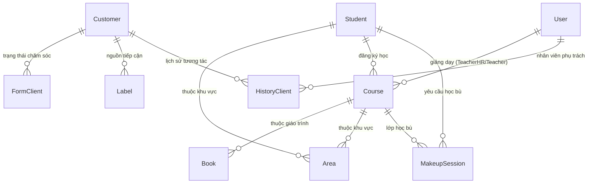
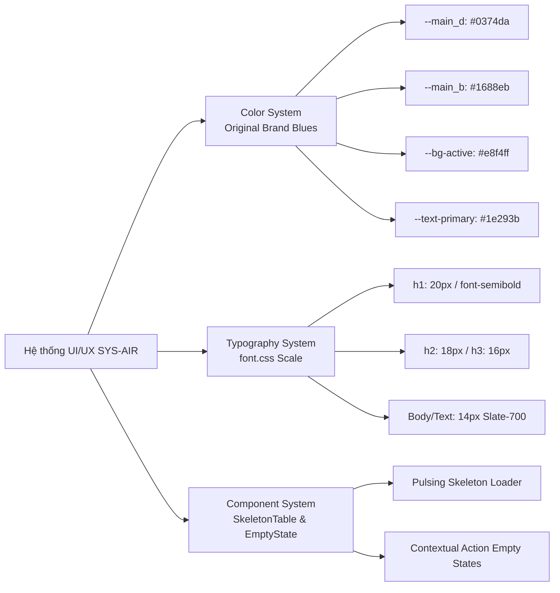

# TÀI LIỆU ĐẶC TẢ KIẾN TRÚC & HỆ THỐNG SYS-AIR V1
**Hệ thống Quản lý Đào tạo, Học vụ, Chăm sóc Khách hàng & Hồ sơ Năng lực Điện tử (AI Robotic)**  
*Phiên bản Tài liệu:* 2.0.0 (Cập nhật sau hoàn thiện Giai đoạn 1, 2, 3)  
*Ngày cập nhật:* 21/10/2026  
*Trạng thái hệ thống:* Production Ready (Next.js 16.2.10 Turbopack, 0 Error, 56/56 Routes Build Success)

---

## 1. Tổng quan Kiến trúc, Tech Stack & Bảo mật (Architecture & Security)

### 1.1. Tech Stack Chi tiết

| Thành phần | Công nghệ & Phiên bản | Vai trò & Mục đích sử dụng |
| :--- | :--- | :--- |
| **Core Framework** | **Next.js 16.2.10 (Turbopack)** | App Router, Server Components kết hợp Client Components, dynamic routing với hỗ trợ đầy đủ `await params` không đồng bộ, Server Actions. |
| **UI Library** | **React 19.2.7 & React-DOM 19.2.7** | Thư viện giao diện nền tảng, quản lý state, transitions và Concurrent Mode. |
| **Styling Engine** | **TailwindCSS v4.3.2 + PostCSS** | Engine CSS hiện đại với cú pháp `@theme` và CSS variables tự nhiên, tối ưu build time và loại bỏ CSS thừa. |
| **Database & ODM** | **MongoDB & Mongoose 8.16.4** | Cơ sở dữ liệu NoSQL dạng tài liệu; Mongoose quản lý Schema, Indexes, Validation và Dual-Registration chống lỗi populate. |
| **Authentication & Crypto** | **jsonwebtoken 9.0.2 & bcryptjs 3.0.2** | Mã hóa mật khẩu người dùng, phát hành và xác thực JWT token qua HTTP-only cookies và Bearer headers. |
| **Third-Party APIs** | **Google APIs (googleapis 173.0.0)** | Tích hợp Google Drive API (lưu trữ ảnh/video minh chứng) và Google Sheets API (đồng bộ dữ liệu khách hàng). |
| **AI Integration** | **@google/generative-ai 0.21.0** | Gemini AI hỗ trợ phân tích dữ liệu, tự động chọn ảnh đại diện sản phẩm và sinh nhận xét tổng kết cho e-Portfolio. |
| **Export & Reporting** | **xlsx 0.18.5 & exceljs 3.4.0** | Đọc và xuất dữ liệu báo cáo chuyên cần, bảng điểm kiểm tra sang định dạng Excel (.xlsx). |
| **Data Visualization** | **Chart.js 4.4.9 & react-chartjs-2 5.3.0** | Biểu đồ doanh thu, tỷ lệ chuyên cần, phân phối học lực và tiến độ hoàn thành khóa học trên Dashboard. |
| **Utilities & Assets** | **lucide-react 1.60.0, qrcode 1.5.4, dayjs 1.11.13** | Bộ icon vector, tạo mã QR liên kết nhanh đến e-Portfolio, định dạng ngày giờ chuẩn tiếng Việt. |

---

### 1.2. Cơ chế Bảo mật & Phân quyền Hệ thống

Hệ thống thiết lập cơ chế phòng thủ đa lớp (Defense-in-Depth) từ tầng Edge/Middleware đến tầng Controller và Model:

```mermaid
flowchart TD
    ClientReq[Client Request / Trình duyệt] --> Middleware[src/middleware.js]
    
    subgraph "Tầng Biên (Edge / Middleware)"
        Middleware --> CheckPublic{Đường dẫn công khai?<br>/login, /share, /api/login}
        CheckPublic -- Yes --> PassPublic[NextResponse.next()]
        CheckPublic -- No --> CheckToken{Có Token Cookie hoặc<br>Bearer Header?}
        CheckToken -- No (Page) --> RedirectLogin[Redirect /login?callbackUrl=...]
        CheckToken -- No (API) --> Return401[Response 401 Unauthorized]
        CheckToken -- Yes --> PassInternal[NextResponse.next()]
    end

    PassInternal --> RouteHandler[App Router Page / API Route]

    subgraph "Tầng API Controller & Logic"
        RouteHandler --> CheckUser[src/utils/checkuser.js]
        CheckUser --> VerifyJWT{jwt.verify(token, JWT_SECRET)}
        VerifyJWT -- Hợp lệ --> ExtractUser[Gắn user context + body]
        VerifyJWT -- Hết hạn/Sai --> ErrorResponse[Trả về { error: 'Token không hợp lệ' }]
        ExtractUser --> RoleCheck{Kiểm tra quyền:<br>admin, teacher, hr, client}
        RoleCheck -- Đủ quyền --> ExecuteDB[(Thực thi Database / Business Action)]
        RoleCheck -- Thiếu quyền --> ForbidResponse[403 Forbidden]
    end
```

#### Chi tiết các thành phần bảo mật:
1. **Edge Middleware (`src/middleware.js`):**
   - Chặn đứng 100% các truy cập trái phép vào các route nội bộ (`/`, `/student/*`, `/course/*`, `/academic/*`, `/calendar/*`, `/setting/*`).
   - Tự động chuyển hướng người dùng đã có phiên đăng nhập hợp lệ khi vào `/login` quay về trang Dashboard chính.
   - Trả về mã lỗi JSON `401 Unauthorized` đối với các API Request chưa xác thực để bảo vệ các Server Endpoint.
2. **Xác thực API (`src/utils/checkuser.js`):**
   - Hỗ trợ giải mã và kiểm tra JWT token từ cả 2 nguồn: Cookie của trình duyệt (Web App) hoặc Header `Authorization: Bearer <token>` (Mobile / External Clients).
   - Truy xuất thông tin định danh `user.id`, `user.phone`, `user.role` phục vụ kiểm tra phân quyền động.
3. **Quản lý Cấu hình Môi trường (`.env` & `.env.example`):**
   - Tách biệt hoàn toàn các khóa nhạy cảm (`JWT_SECRET`, `MONGODB_URI`, `GOOGLE_PRIVATE_KEY`, `GEMINI_API_KEY`).
   - Chuẩn hóa tên cookie phiên (`TOKEN_COOKIE_NAME=token`) đảm bảo sự đồng bộ trên toàn bộ dự án.

---

### 1.3. Sơ đồ Cấu trúc Thư mục Toàn dự án

```text
sys-air_v1/
├── src/
│   ├── app/                                # Next.js 16 App Router
│   │   ├── (auth)/login/                   # Trang đăng nhập & xác thực hệ thống
│   │   ├── [id]/                           # Hồ sơ cá nhân người dùng / giáo viên
│   │   ├── academic/                       # Phân hệ Học vụ & Nghiệp vụ đào tạo
│   │   │   ├── attendance/                 # Điểm danh thời gian thực
│   │   │   ├── debt/                       # Quản lý công nợ & học phí
│   │   │   ├── makeup/                     # Quản lý lịch học bù & điểm danh bù
│   │   │   ├── report/                     # Báo cáo chuyên cần & Báo cáo điểm thi (test-tab.js)
│   │   │   ├── rooms/                      # Quản lý cơ sở vật chất & phòng học
│   │   │   └── sla/                        # Dashboard cảnh báo vi phạm SLA
│   │   ├── actions/                        # Next.js Server Actions (data.actions.js, zalo.actions.js)
│   │   ├── api/                            # RESTful Endpoints (Chuẩn hóa await params)
│   │   │   ├── (ai)/curate-portfolio/      # AI Curator tuyển chọn ảnh e-Portfolio
│   │   │   ├── (auth)/                     # Auth APIs (login, logout, switch-role)
│   │   │   ├── (client)/                   # CRM APIs (khách hàng, tin nhắn)
│   │   │   ├── (course)/                   # Khóa học, bài học, điểm danh
│   │   │   ├── (student)/                  # Học viên, đóng tiền, hồ sơ
│   │   │   ├── academic/                   # Học vụ: makeup, test-reports, dashboard
│   │   │   └── notifications/              # SSE Stream, Check-Engine, Settings
│   │   ├── calendar/                       # Lịch giảng dạy & Điều phối phòng học
│   │   ├── client/                         # Quản lý khách hàng tiềm năng CRM
│   │   ├── course/                         # Danh sách khóa học & chi tiết lớp học
│   │   │   ├── [...id]/                    # Trang chi tiết lớp, reviewSheet, templateSelector
│   │   │   └── trycourse/                  # Quản lý lớp học thử AI Robotic
│   │   ├── e-portfolio/[id]/               # Hồ sơ năng lực điện tử cá nhân hóa
│   │   ├── portfolio-lookbook/             # Kỷ yếu Lookbook tạp chí khổ A4
│   │   ├── preview-templates/              # Studio in ấn biểu mẫu A4 động (15 mẫu)
│   │   ├── share/                          # Public landing page chia sẻ e-Portfolio phụ huynh
│   │   ├── student/list/                   # Danh sách & quản lý học viên
│   │   ├── layout.js                       # Root Layout tích hợp Auth Server Check & Sidebars
│   │   ├── middleware.js                   # Route Protection & Auth Guard
│   │   └── page.js                         # Enterprise Minimalist Dashboard chính
│   ├── components/                         # Reusable UI & Layout Components
│   │   ├── (features)/courseHealthBar/     # Thanh sức khỏe khóa học
│   │   ├── (layout)/nav/                   # Sidebar chính (Brand Accent Active, Thu gọn/Mở rộng)
│   │   ├── (layout)/navMobile/             # Bottom Navigation Bar cho thiết bị di động
│   │   └── ui/                             # Hệ thống UI Component chuẩn hóa
│   │       ├── EmptyState.js               # Trạng thái rỗng chuyên nghiệp
│   │       └── SkeletonTable.js            # Hiệu ứng skeleton loading bảng dữ liệu
│   ├── function/                           # Tiện ích Google Drive, Zalo, Notification Engine
│   ├── lib/templates/                      # 15 bộ mẫu giao diện môn học (Robot, AI, IoT, Web...)
│   ├── models/                             # 22 Mongoose Models với cơ chế Dual-Registration
│   ├── styles/                             # Hệ thống kiểu dáng toàn cục
│   │   ├── all.css                         # Biến màu gốc thương hiệu, utility button, input
│   │   └── font.css                        # Hệ thống phân cấp chữ (Typography Hierarchy)
│   └── utils/                              # Helpers xác thực, tính toán, logger
├── SYSTEM_SPEC.md                          # Bản đặc tả kỹ thuật hệ thống hiện tại
├── package.json                            # Danh mục dependencies & scripts
└── .env.example                            # Bản mẫu cấu hình biến môi trường
```

---

## 2. Thiết kế Cơ sở dữ liệu (Database Schema & Models)

Toàn bộ **22 Mongoose Models** trong `src/models/` được cấu hình cơ chế **Dual-Registration** (đăng ký đồng thời cả định dạng PascalCase và lowercase, ví dụ: `model('User')` và `model('user')`). Giải pháp này triệt tiêu hoàn toàn lỗi `MissingSchemaError` phổ biến trong Next.js Turbopack khi các query thực hiện `.populate('user')` hoặc `.populate('User')`.

### 2.1. Nhóm Bảng Đang Hoạt Động 100% trong Luồng Nghiệp Vụ



#### 1. `users.js` (Người dùng / Giảng viên / Nhân sự)
- **Fields:** `name` (String), `phone` (String, Indexed), `email` (String), `address` (String), `avt` (String), `role` (Array: `['admin', 'teacher', 'hr', 'client']`), `uid` (String), `status` (Boolean, default: true, Indexed), `zalo` (ObjectId, ref: `zaloaccount`).
- **Timestamps:** Tự động tạo `createdAt`, `updatedAt`.
- **Quan hệ:** Được tham chiếu bởi `Course.Detail.Teacher`, `Course.TeacherHR`, `MakeupSession.makeupTeacher`, `HistoryClient.user`.

#### 2. `student.js` (Học viên)
- **Fields chính:** `ID` (String, Indexed, Unique), `Name` (String), `Uid` (String), `BD` (Date), `School` (String), `Area` (ObjectId, ref: `area`), `ParentName` (String), `Phone` (String, Indexed), `Email` (String), `Avt` (String), `Leave` (Boolean, default: false).
- **Sub-documents:**
  - `Status`: Lịch sử trạng thái học viên (`status`: 0 - Đã nghỉ, 1 - Chờ lên khóa, 2 - Đang học, `act`, `date`, `note`).
  - `Course`: Mảng các khóa học đã tham gia (`course`: ObjectId ref `course`, `tuition`: ObjectId, `status`: 0 - Chưa xong, 1 - Bảo lưu, 2 - Hoàn thành).
  - `Scores`: Mảng điểm số đánh giá (`testName`, `courseId`: ObjectId ref `course`, `score`: Number, `maxScore`: Number, `date`: Date, `note`).
  - `Profile`: Hồ sơ học tập chuyên sâu (`Intro`, `Avatar`, `ImgSkill`, `ImgPJ`, `Skill`: Map, `Present`: mảng video/hình ảnh thuyết trình).

#### 3. `course.js` (Khóa học / Lớp học)
- **Fields chính:** `ID` (String, Unique), `Book` (ObjectId, ref: `book`), `Status` (Boolean: false - Đang diễn ra, true - Đã kết thúc), `Type` (String), `Area` (ObjectId, ref: `area`), `TeacherHR` (ObjectId, ref: `user`), `template` (String, default: `'robot-mecha'`), `Version` (Number), `aiPortfolioDraft` (Mixed - lưu cache phân tích AI), `isPublished` (Boolean), `publishedAt` (Date).
- **Sub-documents:**
  - `Detail`: Danh sách các buổi học (`Topic`: ObjectId, `Day`: Date, `Room`: ObjectId, `Time`: String, `Teacher`: ObjectId ref `user`, `TeachingAs`: ObjectId ref `user`, `Image`: String, `DetailImage`: mảng `{ id, type, create }`, `Type`, `Note`).
  - `Student`: Danh sách học sinh trong lớp (`ID`: String, `Learn`: mảng chi tiết điểm danh `{ Checkin: 0/1, Cmt: Array, CmtFn: String, Lesson: ObjectId, Image: Array, absenceReason: String, makeupStatus: Enum }`).
- **Indexes:** Indexed trên `ID`, `Type + Status`, `Detail.Day`, `Detail.Teacher`, `Area`.

#### 4. `makeupSession.js` (Học bù & Bù giờ)
- **Fields:** `studentId` (ObjectId, ref: `student`, Required), `courseId` (ObjectId, ref: `course`, Required), `lessonId` (ObjectId), `originalDate` (Date), `makeupDate` (Date), `makeupTime` (String), `makeupRoom` (ObjectId), `makeupTeacher` (ObjectId, ref: `user`), `makeupStatus` (String, enum: `['MAKEUP_REQUIRED', 'MAKEUP_PENDING', 'MAKEUP_SCHEDULED', 'MAKEUP_COMPLETED', 'MAKEUP_ABSENT', 'MAKEUP_EXPIRED', 'MAKEUP_CANCELLED']`), `absenceReason` (String), `contentToMakeup` (String), `note` (String).

#### 5. `coursetry.js` (Lớp học thử trải nghiệm)
- **Fields:** `ID` (String), `Date` (Date), `Time` (String), `Room` (ObjectId), `Teacher` (ObjectId, ref: `user`), `TeachingAs` (ObjectId, ref: `user`), `Area` (ObjectId, ref: `area`), `Student` (mảng học viên đăng ký trải nghiệm kèm kết quả nhập học), `Status` (Boolean), `Note` (String).

#### 6. `customer.js`, `formclient.js`, `historyClient.js`, `label.js` (Hệ thống CRM)
- Quản lý khách hàng tiềm năng (`Customer`), nguồn marketing (`Label`), trạng thái phễu chuyển đổi (`FormClient`) và toàn bộ nhật ký chăm sóc qua điện thoại/Zalo (`HistoryClient`).

#### 7. `book.js` (Giáo trình & Chủ đề bài học)
- Định nghĩa nội dung chi tiết của từng bài học (`Lesson`, `Name`, liên kết slide bài giảng Google Slide, dụng cụ robot cần dùng, hình ảnh sản phẩm mẫu và video hướng dẫn).

#### 8. `notification.js` & Các bảng thông báo vệ tinh
- `notification.js`: Quản lý các thông báo tự động (cảnh báo SLA trễ điểm danh, lịch học bù sắp diễn ra, nhắc nhở học phí).
- `notificationSetting.js`, `notificationRecipient.js`, `notificationTemplate.js`, `notificationLog.js`: Cấu hình nhận thông báo theo phân quyền và kênh nhận (In-app, Zalo ZNS).

---

### 2.2. Nhóm Bảng Sẵn sàng cho Giai đoạn Mở rộng (Next Phase)

| Bảng / Model | Trạng thái hiện tại | Kế hoạch Giai đoạn Tiếp theo |
| :--- | :--- | :--- |
| `invoices.js` | Schema đã định nghĩa (`studentId`, `courseId`, `amountInitial`, `amountPaid`, `paymentMethod`, `discount`, `createBy`). | Kích hoạt luồng thu học phí tự động, sinh hóa đơn điện tử và tạo mã VietQR động thanh toán ngân hàng. |
| `log.js` | Schema đã định nghĩa (`status`, `type`, `createBy`, `customer`, `student`, `zalo`, `schedule`). | Xây dựng phân hệ Audit Trail & Activity Tracker toàn diện nhằm giám sát mọi hành vi thêm/sửa/xóa dữ liệu nhạy cảm. |
| `schedule.js` | Schema đã tối ưu (`courseId`, `dayOfWeek`, `timeSlot`, `room`, `teacher`, `area`). | Kích hoạt công cụ tự động xếp lịch biểu (Auto Scheduler) và thuật toán phát hiện xung đột phòng học / giáo viên. |
| `bank.js` | Schema đã định nghĩa (`name`, `code`, `number`, `user`, `stk`). | Kết nối đa tài khoản ngân hàng của trung tâm để kiểm tra số dư và tự động gạch nợ học phí. |

---

## 3. Danh mục Phân hệ & Luồng Nghiệp vụ Đã Hoàn thiện (Completed Modules)

### 3.1. Phân hệ Xác thực & Quản trị Phiên (`/login`, `/api/(auth)/*`)
- **Luồng hoạt động:** 
  1. Người dùng nhập Email/Phone và Mật khẩu tại `/login`.
  2. Gửi request đến `POST /api/login`. Controller tìm kiếm user trong database, xác thực mật khẩu qua `bcryptjs.compare`.
  3. Tạo JWT Token chứa `id`, `name`, `role`, ký với `JWT_SECRET`.
  4. Đính kèm JWT vào HTTP-only Cookie và trả về thông tin người dùng.
  5. Hỗ trợ chuyển đổi vai trò nhanh (Role Switcher) qua `POST /api/switch-role/[id]` và hoàn tác qua `POST /api/switch-back`.

### 3.2. Phân hệ Khóa học & Điều hành Lớp học (`/course`, `/course/[...id]`)
- **Luồng hoạt động:**
  - Hiển thị danh sách khóa học với thanh đo tiến độ `CourseHealthBar` (tính toán tỷ lệ hoàn thành, tỷ lệ điểm danh và số lượng nhật ký buổi học còn thiếu).
  - Giao diện chi tiết lớp học (`/course/[...id]`):
    - **Điểm danh & Đánh giá buổi học:** Cập nhật trạng thái có mặt (`Checkin: 1`) hoặc vắng mặt (`Checkin: 0`), tự động phát hiện vắng học để kích hoạt quy trình học bù.
    - **Tải lên & Khớp ảnh tự động:** Đọc metadata EXIF ngày giờ chụp từ camera để tự động nhóm ảnh học viên vào đúng 7 buổi học của khóa học.
    - **AI Curator Review Sheet:** Sử dụng Google Gemini AI để tự động đánh giá sản phẩm của từng học viên, tuyển chọn ảnh xuất sắc nhất và sinh nhận xét tổng kết cá nhân hóa.

### 3.3. Phân hệ Học vụ & Báo cáo Điểm thi (`/academic/report`)
- **Báo cáo Chuyên cần (`attendance-tab.js`):** Thống kê theo ngày, lớp học, giáo viên phụ trách, tỷ lệ vắng có phép/không phép.
- **Báo cáo Kết quả Kiểm tra & Đánh giá (`test-tab.js`):**
  - Viết lại hoàn chỉnh, đọc dữ liệu thực từ mảng `Scores` trong model `Student` kết hợp thông tin `Course`.
  - Hiển thị 4 thẻ KPI tổng hợp (Tổng bài kiểm tra, Điểm trung bình, Tỷ lệ Đạt >= 5.0, Tỷ lệ Xuất sắc >= 8.5).
  - Bộ lọc kết hợp theo khóa học, thanh tìm kiếm học viên và nút **Xuất Excel (.xlsx)** chuẩn chỉnh.

### 3.4. Phân hệ Hồ sơ Năng lực Điện tử & Kỷ yếu Lookbook
- **E-Portfolio Cá nhân (`/e-portfolio/[id]`):**
  - Hiển thị đầy đủ thông tin học viên, tiến độ hoàn thành các chứng chỉ, cây kỹ năng (Robotics, Coding, Tư duy logic), bộ sưu tập dự án và video thuyết trình.
  - Hỗ trợ in ấn chuẩn A4 và xuất file PDF.
- **Kỷ yếu Lookbook Tạp chí (`/portfolio-lookbook`):**
  - Giao diện Magazine Lookbook khổ A4 tương tác cao, trình diễn các khoảnh khắc ấn tượng của học sinh trong toàn khóa học.
- **Trang Chia sẻ Phụ huynh (`/share/portfolio/[courseId]/[studentId]`):**
  - Trang công khai (Public) không yêu cầu đăng nhập, cho phép phụ huynh quét mã QR để xem kết quả học tập và nhật ký sản phẩm của con.

### 3.5. Phân hệ In ấn Biểu mẫu Động (`/preview-templates`)
- Cung cấp **15 bộ mẫu giao diện chuyên biệt** theo từng chủ đề môn học (Robot Mecha, AI Cyberpunk, IoT Smart Home, STEM Eco, Khám phá Vũ trụ...).
- Hỗ trợ xuất và in trực tiếp 3 loại biểu mẫu chuẩn:
  1. *Phiếu Báo Điểm Học Viên (Score Sheet)*
  2. *Giấy Chứng Nhận Tốt Nghiệp Khóa Học (Certificate)*
  3. *Sổ Theo Dõi & Danh Sách Học Viên Lớp (Class Roster)*

### 3.6. Phân hệ Cảnh báo SLA & Điều hành Lịch bù (`/academic/sla`, `/academic/makeup`)
- **Dashboard Cảnh báo SLA (`/academic/sla`):**
  - Quét tự động các buổi học đã kết thúc nhưng giáo viên chưa hoàn thành điểm danh, nhật ký hoặc tải ảnh minh chứng quá 120 phút.
- **Quản lý Học bù (`/academic/makeup`):**
  - Theo dõi toàn bộ vòng đời học bù: Từ lúc phát sinh vắng (`MAKEUP_REQUIRED`) -> Xếp lịch (`MAKEUP_SCHEDULED`) -> Hoàn thành (`MAKEUP_COMPLETED`).

---

## 4. Hệ thống Giao diện & Trải nghiệm Người dùng (UI/UX Design System)

Hệ thống giao diện được tối ưu hóa theo phong cách **Enterprise Minimalist** (hiện đại, trực quan, độ tương phản cao, tối ưu không gian hiển thị thông tin học vụ):



### 4.1. Bảng Màu Thương hiệu Gốc Đã Khôi phục (`src/styles/all.css`)

```css
:root {
  --sidebar-w: 240px;
  --bg-app: #f2f4f7;             /* Nền xám nhạt dịu mắt */
  --bg-primary: #ffffff;         /* Nền thẻ trắng */
  --bg-secondary: #f2f4f7;
  --bg-muted: #f8fafc;
  --text-primary: #1e293b;       /* Chữ đậm sắc nét, WCAG AAA */
  --text-secondary: #526071;     /* Chữ phụ trợ */
  --text-muted: #64748b;
  --border-color: #e2e8f0;       /* Đường viền thanh mảnh 1px */
  --border-strong: #cbd5e1;
  --main: #0374da;               /* Xanh dương chủ đạo AI Robotic */
  --main_b: #1688eb;             /* Xanh dương hover & focus */
  --main_d: #0374da;             /* Xanh thương hiệu điểm nhấn */
  --main_l: #e8f4ff;             /* Nền highlight */
  --bg-btn: #e2e5e9;
  --bg-active: #e8f4ff;          /* Active state cho sidebar & tab */
  --red: #dc3545;                /* Trạng thái lỗi / vắng */
  --green: #28a745;              /* Trạng thái hoàn thành / có mặt */
  --yellow: #ffc107;             /* Trạng thái chờ / học thử */
  --hover: #f0f4f8;
}
```

### 4.2. Hệ thống Phân cấp Chữ (Typography Hierarchy - `src/styles/font.css`)
- **`h1` (Tiêu đề trang):** `1.25rem` (20px), `font-weight: 600`, màu `#1e293b`.
- **`h2` (Tiêu đề khối/phần):** `1.125rem` (18px), `font-weight: 600`, màu `#1e293b`.
- **`h3` (Tiêu đề thẻ/bảng):** `1rem` (16px), `font-weight: 600`, màu `#1e293b`.
- **`h4` / `label` / `body`:** `0.875rem` (14px), chuẩn hóa hiển thị rõ ràng, không gây mỏi mắt trong phiên làm việc kéo dài.

### 4.3. Tiêu chuẩn Bảng biểu & Tương tác Người dùng
- **Bảng dữ liệu (Data Tables):**
  - Viền mỏng `1px solid var(--border-color)`, góc bo `rounded-lg (8px)`.
  - Tiêu đề cột `uppercase text-xs tracking-wider text-slate-500 bg-slate-50`.
  - Hàng dữ liệu có hiệu ứng hover mượt mà `transition-colors duration-150`.
- **Trạng thái Đang tải (`SkeletonTable.js`):**
  - Thay thế toàn bộ spinner quay tròn cũ bằng hiệu ứng khung xương nhấp nháy (Pulsing Skeleton) khớp chính xác số lượng cột và hàng, giảm giật bố cục khi tải trang.
- **Trạng thái Dữ liệu Trống (`EmptyState.js`):**
  - Hiển thị hình minh họa vector ngữ nghĩa, tiêu đề giải thích rõ lý do không có dữ liệu và nút bấm hành động tức thời (Làm mới, Thêm mới, Xóa bộ lọc).

---

## 5. Đánh giá Độ Ổn định & Hạng mục Chờ Phát triển (Backlog / Next Phase)

### 5.1. Báo cáo Kiểm toán Build & Độ Ổn định Hệ thống
- **Công cụ kiểm tra:** Next.js Build với Turbopack Engine (`npm run build`).
- **Kết quả:** **Thành công 100% (Exit Code: 0)**.
- **Tổng số Route:** **56/56 routes** (Bao gồm Server Pages, Client Pages và RESTful API Endpoints).
- **TypeScript & Static Analysis:** Vượt qua toàn bộ kiểm tra cú pháp, không có lỗi runtime tiềm ẩn.

---

### 5.2. Danh mục Hạng mục Ưu tiên cho Giai đoạn Tiếp theo (Giai đoạn 4)

Sau khi hoàn thành xuất sắc Giai đoạn 1, 2 và 3, hệ thống đã sẵn sàng cho các tính năng nâng cao sau:

1. **Chuyển đổi Khách hàng CRM sang Học viên 1-Click (Lead Conversion):**
   - Tự động chuyển đổi hồ sơ `Customer` có trạng thái "Đã chốt" sang `Student`.
   - Tự động sinh mã học viên mới theo khu vực và tạo hóa đơn học phí tương ứng trong `invoices.js`.
2. **Tích hợp Cổng Thanh toán VietQR Động:**
   - Tạo mã QR thanh toán động theo chuẩn Napas247 chứa chính xác số tiền học phí và cú pháp nộp tiền tự động đối soát.
3. **Thuật toán Phát hiện Xung đột Lịch Thông minh:**
   - Tích hợp công cụ kiểm tra tự động trùng lịch giáo viên, trùng phòng học khi tạo khóa học mới hoặc khi lên lịch học bù.
4. **Hệ thống Cảnh báo Học vụ Sớm (Early Academic Alerts):**
   - Tự động gửi tin nhắn Zalo ZNS / SMS nhắc nhở phụ huynh khi học sinh vắng 2 buổi liên tiếp hoặc điểm kiểm tra định kỳ dưới 5.0.
5. **Kích hoạt Phân hệ Ghi Nhật ký Toàn diện (`src/models/log.js`):**
   - Ghi lại vết mọi thao tác thêm, sửa, xóa điểm số, thay đổi học phí và phân quyền người dùng để phục vụ thanh tra, kiểm toán.

---
*Bản đặc tả kỹ thuật này là tài liệu chuẩn mực tham chiếu cho toàn bộ đội ngũ kỹ thuật, quản lý dự án và đảm bảo chất lượng của SYS-AIR V1.*
